# Architecture

Truth → Context → Decision → Action → Feedback.



## What happens after the webhook arrives

1. **`POST /signals/job-change`** → `Service.job_change` → `Engine.ingest` (`gde/decisions/engine.py`)
2. **Normalize** the vendor payload into a `JobChange` (`gde/providers/job_change.py`).
3. **Dedupe** in one transaction:
   - same vendor event id → duplicate (also enforced by a UNIQUE constraint)
   - same person and new company from another vendor within 14 days → `DUPLICATE` state
4. **Evaluate** (`Engine._decide`). Each step adds a trace entry:
   1. freshness: at most 30 days
   2. identity (`champions/resolution.py`): MATCH, REVIEW or NO_MATCH
   3. champion evidence (`champions/validation.py`)
   4. account context (`context/truth.py`). The CRM is the system of record; if it is down, HOLD.
   5. qualification (`accounts/qualification.py`)
   6. seller suppressions and cooldowns
   7. recent conversations: the model labels prospect utterances; injected text is quarantined
   8. play eligibility (`plays/registry.py`, `config/plays.json`)
   9. rep daily cap
5. **Persist** (`Engine._persist`) in one transaction: the decision with its trace, sources and model calls, the state transition, the outbox row (if DELIVER) and the review item (if NEEDS_REVIEW).
6. **Deliver** (`delivery/worker.py`): look up the Slack message by metadata, post if missing, retry up to 3 times, then mark DELIVERED or DELIVERY_FAILED.
7. **Feedback** (`POST /feedback` → `feedback/service.py`):
   - the state transition is checked against the table in `workflows/state.py`
   - effects are queued: CRM write-back, compensation, suppressions, exclusions
   - a correction re-evaluates the signal

## Decision boundary


## Feedback loop



## Champion resolution



## GTM brief pipeline

`briefs/service.py`:

1. Take two 21-day windows of conversations.
2. Quarantine text that looks like instructions.
3. The model extracts mentions, each with a verbatim quote.
4. Code rejects any quote not found in the source.
5. Code counts conversations per competitor per window.
6. Code writes claims, and each claim cites evidence records.
7. A claim with no resolvable citation is dropped.

## Workflow states

```
RECEIVED → EVALUATING → DELIVER_PENDING → DELIVERED → ACCEPTED → EXECUTED
                      ↘ NEEDS_REVIEW ↺ (reviewer) → EVALUATING | SUPPRESSED
                      ↘ HELD → EVALUATING (retry)
                      ↘ SUPPRESSED
DELIVERED → SNOOZED → DELIVER_PENDING (when it expires)
DELIVERED | ACCEPTED → CORRECTED → EVALUATING (rerun)
DELIVER_PENDING → DELIVERY_FAILED → DELIVER_PENDING
RECEIVED → DUPLICATE
```

Anything else raises `InvalidTransition`, which returns 409 over HTTP and is audited.

## Runtime shapes

| | Local (`make demo`) | Hosted (GitHub Pages) |
|---|---|---|
| Engine | the `gde` package | the same `gde` package, run by Pyodide in the browser |
| Transport | FastAPI at `/api/*`, docs at `/docs` | `gde.bridge.dispatch()` |
| Storage | SQLite in memory | SQLite in memory (in the tab) |
| Model | mock by default, Claude optional | mock only |

Both runtimes expose the same route table; `tests/test_api.py` fails if they differ.
