# Architecture

Truth → Context → Decision → Action → Feedback.



Diagram A shows only what runs. Sources marked **(fixture)** are static rows in `gde/fixtures/world.json`, loaded on seed; nothing ingests them live. The CRM, enrichment and Slack are simulated adapters. Only job-change webhooks go through normalization. The GTM brief is a separate output: it does not feed the decision engine. The decision engine reads conversations itself, through `classify_intent`.

## What happens after the webhook arrives

1. **`POST /signals/job-change`** → `Service.job_change` → `Engine.ingest` (`gde/decisions/engine.py`)
2. **Normalize** the vendor payload into a `JobChange` (`gde/providers/job_change.py`).
3. **Dedupe** in one transaction:
   - same vendor event id → duplicate (also enforced by a UNIQUE constraint)
   - same person and new company from another vendor within 14 days → `DUPLICATE` state
4. **Evaluate** (`Engine._decide`). Each step adds a trace entry:
   1. freshness: at most 30 days
   2. identity (`champions/resolution.py`): MATCH, REVIEW or NO_MATCH
   3. event order: if a newer move for this person was already processed, SUPPRESS (watermark in `subject_watermarks`)
   4. champion evidence (`champions/validation.py`)
   5. account context (`context/truth.py`). The CRM is the system of record; if it is down, HOLD.
   6. qualification (`accounts/qualification.py`)
   7. seller suppressions and cooldowns
   8. recent conversations: the model labels prospect utterances; injected text is quarantined; a label outside the closed set is dropped and confidence is clamped to [0, 1]
   9. play eligibility (`plays/registry.py`, `config/plays.json`)
   10. rep daily cap
5. **Persist** (`Engine._persist`). The `draft_opener` model call runs first, outside any transaction. Then one transaction writes the decision with its trace, sources and model calls, the state transition, the outbox row (if DELIVER) and the review item (if NEEDS_REVIEW).
6. **Deliver** (`delivery/worker.py`): look up the Slack message by metadata, post if missing, retry up to 3 times, then mark DELIVERED or DELIVERY_FAILED. Every outbox row kind gets the same per-row retry and dead-letter handling ([ADR 0005](adr/0005-outbox-and-idempotency.md)).
7. **Feedback** (`POST /feedback` → `feedback/service.py`):
   - the state transition is checked against the table in `workflows/state.py`
   - effects are queued: CRM write-back, compensation, suppressions, exclusions
   - a correction also queues an edit of the posted Slack card (`slack_retract`)
   - a correction re-evaluates the signal

## Decision boundary


## Feedback loop



## Champion resolution



## GTM brief pipeline

`briefs/service.py`:

1. Take two 21-day windows of conversations.
2. Quarantine text that looks like instructions.
3. The model extracts mentions, each with a verbatim quote.
4. Code rejects any quote not found in the source.
5. Code counts conversations per competitor per window.
6. Code writes claims, and each claim cites evidence records.
7. A claim with no resolvable citation is dropped.

## Workflow states

```
RECEIVED → EVALUATING → DELIVER_PENDING → DELIVERED → ACCEPTED → EXECUTED
                      ↘ NEEDS_REVIEW ↺ (reviewer) → EVALUATING | SUPPRESSED
                      ↘ HELD → EVALUATING (retry)
                      ↘ SUPPRESSED
DELIVERED → SNOOZED → DELIVER_PENDING (when it expires)
DELIVERED | ACCEPTED → CORRECTED → EVALUATING (rerun)
DELIVER_PENDING → DELIVERY_FAILED → DELIVER_PENDING
RECEIVED → DUPLICATE
```

Anything else raises `InvalidTransition`, which returns 409 over HTTP and is audited.

## Runtime shapes

| | Local (`make demo`) | Hosted (GitHub Pages) |
|---|---|---|
| Engine | the `gde` package | the same `gde` package, run by Pyodide in the browser |
| Transport | FastAPI at `/api/*`, docs at `/docs` | `gde.bridge.dispatch()` |
| Storage | SQLite in memory; a file with `GDE_DB` (survives restart, startup sweeper) | SQLite in memory (in the tab) |
| Model | mock by default, Claude optional | mock only |

Both runtimes expose the same route table; `tests/test_api.py` fails if they differ.
